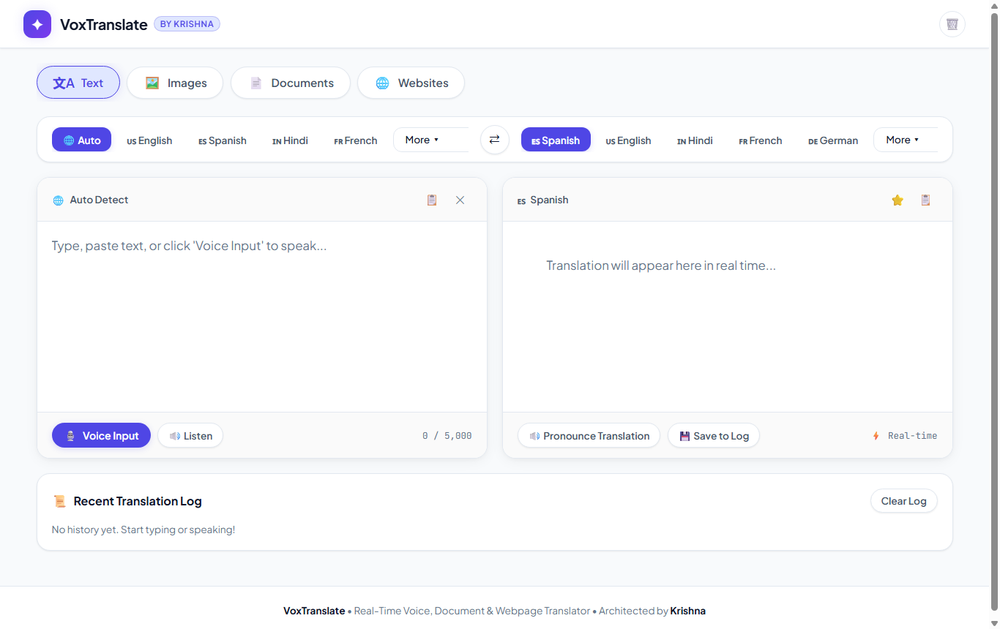

# VoxTranslate Pro 🎙️

An intelligent, real-time multilingual translation platform supporting **Voice Speech-to-Text**, **Text Translation**, **Image OCR Scanning**, **Document File Parsing**, and **Live Webpage Reader** modes. Designed and engineered with a modern, high-contrast light interface and sub-second translation latency.

**Developed by:** [Krishna Deshmukh](https://github.com/krishna-Deshmukh13)  
**Version:** 2.5.0  
**License:** MIT  

---

## 📸 User Interface Preview



---

## 🚀 Key Highlights & Capabilities

- **4 Integrated Translation Modes:**
  - **文A Text & Voice:** Real-time speech-to-text voice input via microphone, smart 350ms debounced typing translation, and instant speech pronunciation.
  - **🖼️ Images (OCR):** In-browser optical character recognition (OCR) via Tesseract.js to scan and translate text from photos, screenshots, and clipboard pastes (**Ctrl + V**).
  - **📄 Documents:** Automated file text extraction and paragraph-by-paragraph translation for **PDF** (via PyMuPDF), **DOCX**, **TXT**, **MD**, and **CSV** files with downloadable output.
  - **🌐 Websites:** Live URL scraper that extracts article headlines and body text to generate a readable, translated view with original source attribution.
- **Microphone Voice Streaming:** Built-in Web Speech API voice capture for browsers, plus PortAudio `sounddevice` with Voice Activity Detection (VAD) for desktop execution.
- **Multi-Engine Translation Resilience:** Primary neural translation through MyMemory with automated fallbacks to prevent 429 rate-limiting.
- **Dual Runtime Support:** Can be launched as a web application (`FastAPI + Uvicorn`) or as a native desktop GUI (`CustomTkinter`).

---

## 🛠️ Technology Stack

| Domain | Technology / Library |
| :--- | :--- |
| **Backend & Web Server** | Python 3, FastAPI, Uvicorn, Pydantic |
| **Web Frontend** | HTML5, CSS Grid/Flexbox, Vanilla JavaScript |
| **Desktop GUI** | CustomTkinter (Permanent Light Mode) |
| **Speech Recognition (STT)** | Web Speech API (`webkitSpeechRecognition`), SpeechRecognition |
| **Speech Synthesis (TTS)** | Web SpeechSynthesis API, gTTS, Windows SAPI5 (pyttsx3) |
| **Document & PDF Processing**| PyMuPDF (`fitz`), Python XML ElementTree |
| **Web Scraping & Extraction**| Requests, BeautifulSoup4 (`bs4`) |
| **Image OCR Scanning** | Tesseract.js (Client-side multi-language OCR) |
| **Translation Engine** | Deep-Translator (Multi-Engine Fallback Cascade) |

---

## 📁 Project Structure

```
real-time-voice-translator/
├── app/
│   ├── __init__.py           # Package initialization & author metadata
│   ├── config.py             # 20+ language mappings (flags, STT/TTS codes)
│   ├── audio_recorder.py     # PortAudio microphone streaming & VAD
│   ├── translator.py         # Multi-engine translation fallback service
│   ├── tts_engine.py         # Speech synthesis & Windows native audio player
│   └── ui.py                 # CustomTkinter native desktop interface
├── assets/
│   ├── screenshot.png        # Full-resolution application screenshot
│   ├── icon.png              # Application logo (PNG)
│   └── icon.ico              # Windows executable icon
├── web/
│   └── index.html            # Single-page web studio application
├── main.py                   # Universal application entry point
├── server.py                 # FastAPI backend server with REST endpoints
├── requirements.txt          # Pinned dependency requirements
├── setup.py                  # Package and build installation configuration
├── LICENSE                   # MIT License
└── README.md                 # Complete documentation
```

---

## ⚡ Quick Start & Installation

### 1. Prerequisites
- Python 3.9, 3.10, 3.11, 3.12, 3.13, or 3.14
- Google Chrome, Microsoft Edge, or any modern web browser

### 2. Clone the Repository
```bash
git clone https://github.com/krishna-Deshmukh13/real-time-voice-translator.git
cd real-time-voice-translator
```

### 3. Install Dependencies
```bash
pip install -r requirements.txt
```

### 4. Launch the Web Studio (Recommended)
```bash
python main.py
```
*Your browser will automatically open at `http://localhost:8000`.*

### 5. Launch the Native Desktop GUI
```bash
python main.py --mode desktop
```

---

## 💡 How It Works

1. **Select Language Pair:** Choose input and output languages using the quick-select pills or dropdown, or click **⇄** to swap them.
2. **Text & Voice Translation:** Type in the editor or click **`🎙️ Voice Input`** to speak hands-free. Real-time translation appears instantly with audio pronunciation via **`🔊 Listen`**.
3. **Scan Photos:** Switch to **Images**, drag & drop or paste an image (`Ctrl + V`), and watch OCR extract and translate text.
4. **Translate Documents:** Switch to **Documents**, upload a `.pdf` or `.docx` file, and download the translated `.txt` file when done.
5. **Read Foreign Websites:** Switch to **Websites**, paste an article URL, and view translated sections side-by-side.

---

## 📜 License

Created & maintained by **[Krishna Deshmukh](https://github.com/krishna-Deshmukh13)**.  
Released under the [MIT License](LICENSE).
