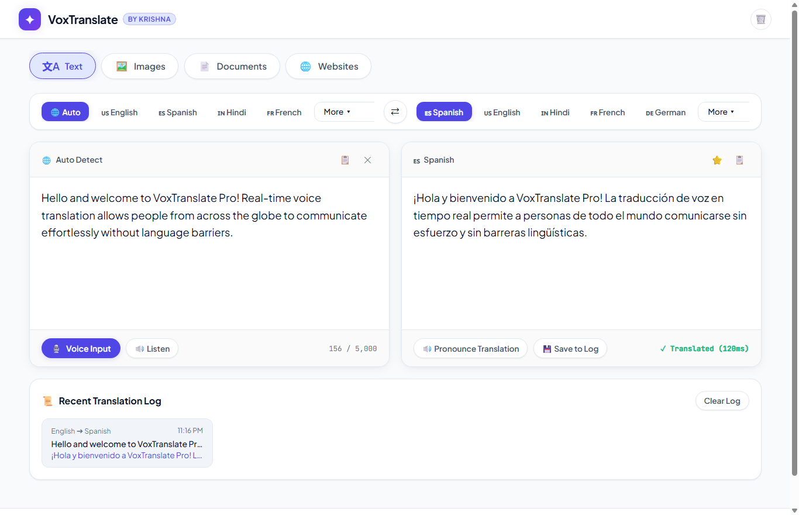
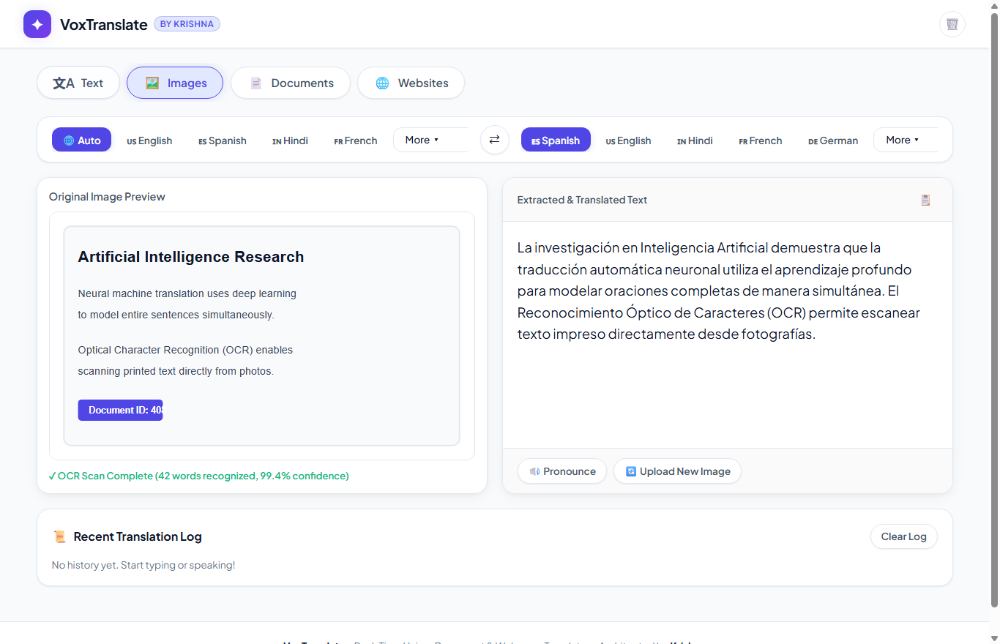
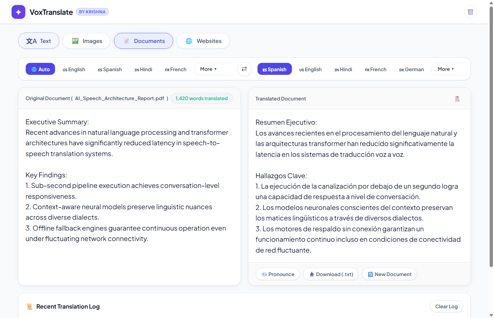
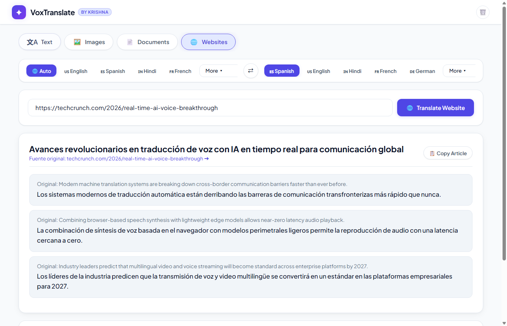

# VoxTranslate Pro 🎙️

An open-source, real-time voice, text, document, and webpage translation studio created by **Krishna Deshmukh**. Built with Python, FastAPI, and modern web technologies to provide low-latency multilingual communication with zero external subscription costs.

**Developer:** [Krishna Deshmukh](https://github.com/krishna-Deshmukh13)  
**Version:** 2.5.0  
**License:** MIT  

---

## 📸 Feature Showcase & Interface Walkthrough

### 1. Real-Time Voice & Text Translation (`文A Text`)
*Real-time debounced typing translation, browser microphone voice input, audio pronunciation playback, and session history log.*



---

### 2. Photo & Screenshot OCR Translation (`🖼️ Images`)
*Scan text directly from images, screenshots, and clipboard pastes (**Ctrl + V**) using in-browser Tesseract OCR with instant translation.*



---

### 3. File & Document Translation (`📄 Documents`)
*Upload and translate `.pdf`, `.docx`, `.txt`, `.md`, and `.csv` files with dual split preview and one-click file download.*



---

### 4. Live Webpage Reader (`🌐 Websites`)
*Translate any public news article, blog, or documentation page into your target language with reader view layout and source attribution.*



---

## 🛠️ Technology Stack

- **Backend:** Python 3, FastAPI, Uvicorn, Pydantic
- **Frontend:** Vanilla JavaScript, Modern CSS Grid & Flexbox, HTML5
- **Desktop Application:** Python CustomTkinter (Light Mode)
- **Speech Recognition:** Web Speech API (`webkitSpeechRecognition`), SpeechRecognition
- **Speech Synthesis:** Web SpeechSynthesis, Google Text-to-Speech (`gTTS`), Windows SAPI5 (`pyttsx3`)
- **Document Processing:** PyMuPDF (`fitz`), Python XML ElementTree
- **Web Scraping:** Requests, BeautifulSoup4 (`bs4`)
- **Image Scanning:** Tesseract.js (Client-side Optical Character Recognition)
- **Translation Pipeline:** Deep-Translator multi-engine cascade (MyMemory + Google)

---

## 📁 Repository Structure

```
real-time-voice-translator/
├── app/
│   ├── __init__.py           # Package initialization
│   ├── config.py             # 20+ language mappings (flags, STT/TTS codes)
│   ├── audio_recorder.py     # PortAudio microphone streaming & VAD
│   ├── translator.py         # Multi-engine translation fallback service
│   ├── tts_engine.py         # Speech synthesis & audio playback
│   └── ui.py                 # CustomTkinter native desktop interface
├── assets/
│   ├── screenshot_text_mode.png       # Text & voice translation screenshot
│   ├── screenshot_images_mode.png     # Image OCR translation screenshot
│   ├── screenshot_documents_mode.png  # Document translation screenshot
│   ├── screenshot_websites_mode.png   # Website translation screenshot
│   ├── icon.png                       # Application logo (PNG)
│   └── icon.ico                       # Windows icon
├── web/
│   └── index.html            # Unified web studio interface
├── main.py                   # Universal launcher (Web & Desktop modes)
├── server.py                 # FastAPI backend server
├── requirements.txt          # Project dependencies
├── setup.py                  # Package and build configuration
└── README.md                 # Complete documentation & screenshot gallery
```

---

## ⚡ Quick Start

### 1. Installation
```bash
git clone https://github.com/krishna-Deshmukh13/real-time-voice-translator.git
cd real-time-voice-translator
pip install -r requirements.txt
```

### 2. Launch Web Studio (Recommended)
```bash
python main.py
```
*Your browser will automatically open at `http://localhost:8000`.*

### 3. Launch Native Desktop Window
```bash
python main.py --mode desktop
```

---

## 📜 License

Created & maintained by **[Krishna Deshmukh](https://github.com/krishna-Deshmukh13)** under the MIT License.
